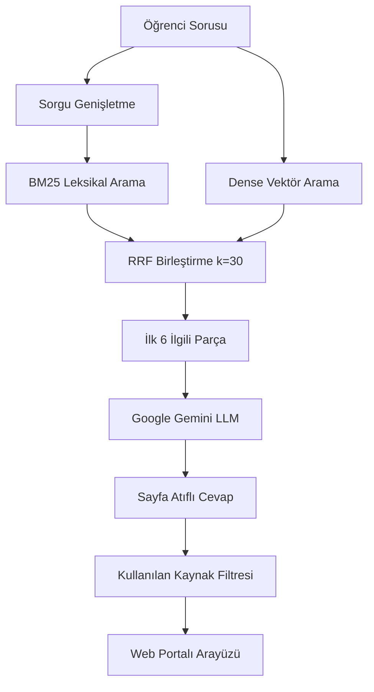

# Kayseri Üniversitesi (KAYÜ) Mevzuat Danışmanı (Prototip)

> Kayseri Üniversitesi senato yönetmelik ve yönergeleri üzerinde çalışan, saf Python tabanlı hibrit arama (BM25 + Vektör) ve soru-cevap prototipi.

[](https://www.python.org/)
[](https://fastapi.tiangolo.com/)
[](https://www.trychroma.com/)
[](https://ai.google.dev/)
[](LICENSE)

---

> ⚠️ **Prototip Bildirimi:** Bu proje henüz geliştirme aşamasında olan bir **akademik/öğrenci prototipidir**. Sistem yalnızca aşağıda listelenen 19 adet resmi PDF belgesini referans alarak yanıt üretir. Herhangi bir resmi bağlayıcılığı yoktur; resmi işlemlerde Kayseri Üniversitesi Öğrenci İşleri Daire Başkanlığı ve ilgili birimlerin kararları esastır.

---

## 📜 Kapsamdaki 19 Resmi Belge

Sistem, Kayseri Üniversitesi Senatosu tarafından yayımlanan güncel 19 resmi mevzuat metnini indekslemektedir:

### Yönetmelikler (3 Belge)
1. **Ön Lisans ve Lisans Eğitim-Öğretim ve Sınav Yönetmeliği** (12 sayfa)
2. **Lisansüstü Eğitim ve Öğretim Yönetmeliği** (24 sayfa)
3. **YÖK Kurum İçi ve Kurumlar Arası Yatay Geçiş, ÇAP ve Yandal Yönetmeliği** (13 sayfa)

### Yönergeler ve Usul Esaslar (16 Belge)
4. **Kurum İçi Yatay Geçiş, Çift Anadal (ÇAP) ve Yandal Yönergesi** (8 sayfa)
5. **Yaz Okulu Yönergesi** (3 sayfa)
6. **Ön Lisans ve Lisans Sınav ve Başarı Değerlendirme Yönergesi** (9 sayfa)
7. **Ders Muafiyeti ve İntibak İşlemleri Yönergesi** (4 sayfa)
8. **Öğrenci Haklı ve Geçerli Nedenler Yönergesi (Mazeret Esasları)** (4 sayfa)
9. **Azami Öğrenim Süresi Sonunda Mezun Olamayanlar Yönergesi** (6 sayfa)
10. **İşletmede Mesleki Eğitim Yönergesi** (7 sayfa)
11. **Ön Lisans ve Lisans Düzeyinde Uygulamalı Eğitimler Yönergesi** (10 sayfa)
12. **AKTS Kredilendirme Yönergesi** (4 sayfa)
13. **Bologna Süreci Uyum Yönergesi** (3 sayfa)
14. **Özel Öğrenci Yönergesi** (4 sayfa)
15. **Yabancı Uyruklu Öğrenci Başvuru ve Kayıt Yönergesi** (7 sayfa)
16. **Mikro Yeterlilik Yönergesi** (5 sayfa)
17. **Yabancı Dil Muafiyet Sınavları Yönergesi** (5 sayfa)
18. **Önceki Öğrenmelerin Tanınması Yönergesi** (3 sayfa)
19. **Üniversite Seçmeli Dersler Yönergesi** (3 sayfa)

---

## 🔍 Çalışma Mantığı ve Mimari

Bu projede harici büyük çerçeveler (LangChain, LlamaIndex vb.) yerine temel arama ve birleştirme adımları saf Python ile kurgulanmıştır:

- **Hibrit Arama (BM25 + Vektör):** Mevzuat dilindeki "FF", "GANO 2.50", "3 iş günü", "20 AKTS" gibi teknik ifadeleri yakalamak için leksikal (BM25) arama ile semantik yoğun vektör araması (`multilingual-e5-base`) birlikte çalıştırılır.
- **RRF Sıralaması ve Program Uyumu:** İki farklı arama motorundan gelen sonuçlar Reciprocal Rank Fusion (RRF, k=30) formülüyle ve lisans/lisansüstü kapsam ağırlıklandırmasıyla birleştirilir, en alakalı ilk 6 parça seçilir.
- **Kaynak Gösterme ve Sayfa Atfı:** LLM motoru (Google Gemini 3.5 Flash) yalnızca seçilen bağlamdaki resmi maddelere dayanarak cevap üretir ve her bilginin sonuna `[belge.pdf, s.X]` formatında sayfa atfı ekler. İlgili konu 19 belgede yer almıyorsa tahminde bulunmaz.
- **Dinamik Kaynak Filtreleme:** Arayüzde sadece cevap metninde bizzat atıf yapılan resmi belge parçaları akordiyon olarak listelenir, kullanılmayan parçalar elenir.



---

## 📊 Arama Testleri ve Karşılaştırma

Sistem, 19 resmi belgenin tamamını kapsayacak şekilde hazırlanmış, 40'ı doğrudan mevzuat içi ve 10'u kapsam dışı olmak üzere **50 gerçekçi öğrenci sorusu** içeren test seti (`eval/questions.json`) üzerinde denenmiştir. Sorular resmi kitapçık diliyle değil, öğrencilerin doğal konuşma diliyle (*"alttan tek dersim kaldı", "yaz okulunda başka üniden ders alsam", "dönem dondurma"* vb.) hazırlanmıştır:

| Yöntem | Hit@1 | Hit@3 | MRR | Açıklama |
| :--- | :---: | :---: | :---: | :--- |
| **Saf Vektör Arama** (`multilingual-e5-base`) | %35.0 | %55.0 | 0.468 | Doğal konuşma dilindeki kısaltma ve teknik terimleri kaçırabiliyor. |
| **BM25 + Vektör Hibrit (RRF k=30)** | **%70.0** | **%100.0** | **0.846** | **Çift yönlü sorgu temsili, mevzuat terminolojisi genişletmesi ve RRF konsensüsü ile yüksek başarı sağlandı.** |

- **Cevaplı Sorular Ortalama Kosinüs Mesafesi:** `0.135` (İlgili parçalarda yüksek yakınlık)
- **Cevapsız Sorular Ortalama Kosinüs Mesafesi:** `0.189` (Kapsam dışı sorularda belirgin uzaklık, halüsinasyonu engellemede eşik sağlar)

*Ayrıntılı test kayıtları ve geçmiş deneyler [eval/sonuclar.md](eval/sonuclar.md) dosyasında yer almaktadır.*

---

## 💻 Web Arayüzü

- Ekranın merkezinde dengeli ve sade web portalı tasarımı (`max-width: 880px`).
- Üst bardan açılabilen **"19 Resmi Belge İndeksi"** modal penceresi.
- Yanıtları panoya kopyalama butonu.
- Cevap altında dayanak alınan yönetmelik sayfasının orijinal metnini gösteren akordiyon.

---

## 📁 Dizin Yapısı

```
kayu-rag/
├── data/
│   ├── yonergeler/           # 16 adet yönerge PDF'i
│   ├── yonetmelikler/        # 3 adet yönetmelik PDF'i
│   └── envanter.csv          # PDF metin katmanı, karakter ve sayfa dökümü
├── db/                       # ChromaDB kalıcı vektör indeksi (git'e dahil edilmez)
├── eval/
│   ├── questions.json        # 50 soruluk doğal insan dili test veri seti
│   ├── run_eval.py           # Benchmark scripti
│   └── sonuclar.md           # Deney karşılaştırma raporu
├── src/
│   ├── api.py                # FastAPI REST API ve sunucu
│   ├── generate.py           # Hibrit arama ve Gemini yanıt motoru
│   └── make_inventory.py     # PDF envanter denetimi
├── web/
│   ├── index.html            # Web arayüzü
│   ├── style.css             # Arayüz stilleri
│   └── app.js                # İstemci mantığı
├── mini_rag.py               # Saf Python hibrit arama çekirdeği
├── requirements.txt          # Python bağımlılıkları
├── run.sh                    # Tek komutla başlatma scripti
├── .env.example              # Çevre değişkeni örneği
└── README.md                 # Proje dokümantasyonu
```

---

## 🛠️ Kurulum ve Çalıştırma

### Gereksinimler
- Python 3.10 veya üzeri
- Google Gemini API Anahtarı ([Google AI Studio](https://aistudio.google.com/)'dan temin edilebilir)

### 1. Depoyu Klonlayın
```bash
git clone https://github.com/erimlers/kayu-rag.git
cd kayu-rag
```

### 2. Bağımlılıkları Yükleyin
```bash
pip install -r requirements.txt
```

### 3. API Anahtarınızı Tanımlayın
```bash
cp .env.example .env
```
`.env` dosyasını açıp anahtarınızı girin:
```env
GEMINI_API_KEY=AIzaSy...
```

### 4. Sistemi Başlatın
Hazır script ile:
```bash
chmod +x run.sh
./run.sh
```

Veya doğrudan Uvicorn ile:
```bash
python3 -m uvicorn src.api:app --host 127.0.0.1 --port 8000 --reload
```

Arayüze erişim: **`http://127.0.0.1:8000`**

### 5. Değerlendirmeyi Çalıştırma
```bash
python3 eval/run_eval.py
```

---

## ⚖️ Lisans

Bu proje [MIT Lisansı](LICENSE) altında açık kaynak olarak paylaşılmıştır.
Mevzuat metinlerinin tüm hakları Kayseri Üniversitesi'ne aittir.
