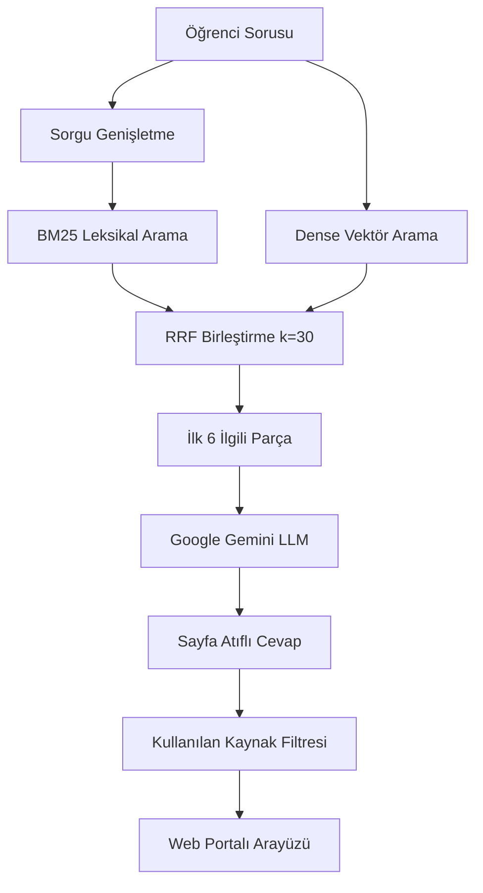

# Kayseri Üniversitesi (KAYÜ) Mevzuat Danışmanı (Prototip)

> Kayseri Üniversitesi senato yönetmelik ve yönergeleri üzerinde çalışan, saf Python tabanlı hibrit arama (BM25 + Vektör) ve soru-cevap prototipi.

[](https://www.python.org/)
[](https://fastapi.tiangolo.com/)
[](https://www.trychroma.com/)
[](https://ai.google.dev/)
[](LICENSE)

---

> ⚠️ **Prototip Bildirimi:** Bu proje henüz geliştirme aşamasında olan bir **akademik/öğrenci prototipidir**. Sistem yalnızca aşağıda listelenen 19 adet resmi PDF belgesini referans alarak yanıt üretir. Herhangi bir resmi bağlayıcılığı yoktur; resmi işlemlerde Kayseri Üniversitesi Öğrenci İşleri Daire Başkanlığı ve ilgili birimlerin kararları esastır.

---

## 📜 Kapsamdaki 19 Resmi Belge

Sistem, Kayseri Üniversitesi Senatosu tarafından yayımlanan güncel 19 resmi mevzuat metnini indekslemektedir:

### Yönetmelikler (3 Belge)
1. **Ön Lisans ve Lisans Eğitim-Öğretim ve Sınav Yönetmeliği** (12 sayfa)
2. **Lisansüstü Eğitim ve Öğretim Yönetmeliği** (24 sayfa)
3. **YÖK Kurum İçi ve Kurumlar Arası Yatay Geçiş, ÇAP ve Yandal Yönetmeliği** (13 sayfa)

### Yönergeler ve Usul Esaslar (16 Belge)
4. **Kurum İçi Yatay Geçiş, Çift Anadal (ÇAP) ve Yandal Yönergesi** (8 sayfa)
5. **Yaz Okulu Yönergesi** (3 sayfa)
6. **Ön Lisans ve Lisans Sınav ve Başarı Değerlendirme Yönergesi** (9 sayfa)
7. **Ders Muafiyeti ve İntibak İşlemleri Yönergesi** (4 sayfa)
8. **Öğrenci Haklı ve Geçerli Nedenler Yönergesi (Mazeret Esasları)** (4 sayfa)
9. **Azami Öğrenim Süresi Sonunda Mezun Olamayanlar Yönergesi** (6 sayfa)
10. **İşletmede Mesleki Eğitim Yönergesi** (7 sayfa)
11. **Ön Lisans ve Lisans Düzeyinde Uygulamalı Eğitimler Yönergesi** (10 sayfa)
12. **AKTS Kredilendirme Yönergesi** (4 sayfa)
13. **Bologna Süreci Uyum Yönergesi** (3 sayfa)
14. **Özel Öğrenci Yönergesi** (4 sayfa)
15. **Yabancı Uyruklu Öğrenci Başvuru ve Kayıt Yönergesi** (7 sayfa)
16. **Mikro Yeterlilik Yönergesi** (5 sayfa)
17. **Yabancı Dil Muafiyet Sınavları Yönergesi** (5 sayfa)
18. **Önceki Öğrenmelerin Tanınması Yönergesi** (3 sayfa)
19. **Üniversite Seçmeli Dersler Yönergesi** (3 sayfa)

---

## 🔍 Çalışma Mantığı ve Mimari

Bu projede harici büyük çerçeveler (LangChain, LlamaIndex vb.) yerine temel arama ve birleştirme adımları saf Python ile kurgulanmıştır:

- **Belge ve Madde Başlıklı Parçalama (Enriched Chunking):** Her metin parçasının başına ait olduğu yönergenin/yönetmeliğin resmi adı ve sayfadaki madde başlıkları (`[Belge Adı | Konu (MADDE X)]`) otomatik olarak eklenir.
- **Türkçe Kök/ASCII Destekli BM25 + Vektör Hibrit Arama:** Yazım hatalarına, Türkçe karakter eksikliklerine ve çekim eklerine dayanıklı morfolojik BM25 indekslemesi ile semantik yoğun vektör araması (`multilingual-e5-base`) birlikte çalıştırılır.
- **LLM Sorgu Yeniden Yazımı (`src/query_rewrite.py`):** Öğrencilerin yazdığı tek kelimelik, devrik veya yarım bırakılmış ifadeler (*"muafiyeti geçemezsem", "ff alırsam", "tek ders"*) kural uydurmadan resmi mevzuat terminolojisine dönüştürülür ve öğrenim düzeyi (ön lisans/lisans vs. lisansüstü) tespit edilir.
- **RRF Sıralaması ve Sayfa Tekilleştirme:** Sonuçlar Reciprocal Rank Fusion (RRF, k=30) ile birleştirilir ve aynı sayfadan gelen parçalar tekilleştirilerek en alakalı sayfalar seçilir.
- **Kapsam Ayrımlı Yanıt ve Abstention Kontrolü:** LLM motoru farklı yönergeleri (ör. önceki öğrenmelerin tanınması ile muafiyet sınavları) birbirine karıştırmadan sayfa atfıyla (`[belge.pdf, s.X]`) yanıt üretir; kısmi bilgi varsa açıklar, yalnızca tamamen kapsam dışı konularda çekimser (abstention) kalır.



---

## 📊 Değerlendirme ve Doğruluk Analizi (Overfit'siz Benchmark)

Değerlendirme sürecinde veri sızıntısını (overfit) önlemek için eski geliştirme seti (`eval/dev.json`) ayrılmış; sistem çıktılarına bakılmadan 19 resmi PDF belgesinden **bağımsız ve SHA-256 ile kilitlenmiş** üç yeni değerlendirme seti oluşturulmuştur:

1. **Kilitli Test Seti (`eval/test_locked.json`, 80 soru):** Doğal tam cümleli öğrenci soruları (geliştirme boyunca hiç açılmamış, tek seferlik final ölçüm).
2. **Kısa / Gürültülü Stres Seti (`eval/noisy.json`, 60 soru):** Tek kelime, yarım cümle, yazım hatalı ve günlük öğrenci argosu (*"ff alırsam", "muafiyeti geçemezsem", "staj sigortası kim ödüyo"* vb.).
3. **Cevapsız Set (`eval/unanswerable.json`, 30 soru):** 15 tamamen kapsam dışı + 15 mevzuata yakın görünüp belgelerde cevabı olmayan soru.

| Veri Seti | Soru Sayısı | Hit@1 (%95 GA) | Hit@3 (%95 GA) | Hit@5 | MRR | Uçtan Uca Doğru+Kısmen (LLM Hakem) | Gereksiz "Bilgi Yok" (False Abstention) |
| :--- | :---: | :---: | :---: | :---: | :---: | :---: | :---: |
| **Kilitli Test Seti** (`test_locked.json`) | 80 | **%80.0** (%71.2–%88.8) | **%95.0** (%90.0–%98.8) | **%98.8** | **0.875** | **%88.8** (%81.2–%95.0) | **%0.0** (0/80) |
| **Kısa / Gürültülü Set** (`noisy.json`) | 60 | **%61.7** (%50.0–%73.3) | **%88.3** (%80.0–%95.0) | **%95.0** | **0.740** | **%96.7** (%91.7–%100.0) | **%0.0** (0/60) |
| **Geliştirme Seti** (`dev.json`) | 40 | **%65.0** (%50.0–%80.0) | **%95.0** (%87.5–%100.0) | **%97.5** | **0.769** | - | - |

- **Kapsam Dışı / Cevapsız Sorularda Doğru Çekimserlik (`unanswerable.json`, 30 soru):** **%86.7** (%95 GA: %73.3–%96.7).
- **Sınırlılıklar:** 80 soruluk test seti orta ölçekli bir akademik benchmark olup %95 bootstrap güven aralıkları tabloda açıkça paylaşılmıştır. Sistem yalnızca 19 PDF'te yer alan genel senato mevzuatını kapsar; bölüm bazlı müfredat/dil bilgisi veya güncel idari duyurular kapsam dışıdır.

*Ayrıntılı deney kayıtları ve ablation sonuçları [eval/sonuclar.md](eval/sonuclar.md) dosyasında yer almaktadır.*

---

## 💻 Web Arayüzü

- Ekranın merkezinde dengeli ve sade web portalı tasarımı (`max-width: 880px`).
- Üst bardan açılabilen **"19 Resmi Belge İndeksi"** modal penceresi.
- Yanıtları panoya kopyalama butonu.
- Cevap altında dayanak alınan yönetmelik sayfasının orijinal metnini gösteren akordiyon.

---

## 📁 Dizin Yapısı

```
kayu-rag/
├── data/
│   ├── yonergeler/           # 16 adet yönerge PDF'i
│   ├── yonetmelikler/        # 3 adet yönetmelik PDF'i
│   └── envanter.csv          # PDF metin katmanı, karakter ve sayfa dökümü
├── db/                       # ChromaDB kalıcı vektör indeksi (git'e dahil edilmez)
├── config/
│   └── retrieval.yaml        # Retrieval ve RRF hiperparametreleri
├── eval/
│   ├── dev.json              # 50 soruluk geliştirme seti
│   ├── test_locked.json      # 80 soruluk kilitli final test seti
│   ├── test_locked.sha256    # Test seti bütünlük kilidi
│   ├── noisy.json            # 60 soruluk kısa/gürültülü stres seti
│   ├── unanswerable.json     # 30 soruluk cevapsız/kapsam dışı set
│   ├── judge.py              # Uçtan uca LLM-Hakem değerlendirme modülü
│   ├── run_eval.py           # Retrieval + E2E + Bootstrap GA benchmark scripti
│   └── sonuclar.md           # Deney karşılaştırma raporu
├── src/
│   ├── api.py                # FastAPI REST API ve sunucu
│   ├── generate.py           # Hibrit arama ve Gemini yanıt motoru
│   ├── query_rewrite.py      # LLM tabanlı sorgu yeniden yazma modülü
│   └── make_inventory.py     # PDF envanter denetimi
├── web/
│   ├── index.html            # Web arayüzü
│   ├── style.css             # Arayüz stilleri
│   └── app.js                # İstemci mantığı
├── mini_rag.py               # Saf Python hibrit arama çekirdeği
├── requirements.txt          # Python bağımlılıkları
├── run.sh                    # Tek komutla başlatma scripti
├── .env.example              # Çevre değişkeni örneği
└── README.md                 # Proje dokümantasyonu
```

---

## 🛠️ Kurulum ve Çalıştırma

### Gereksinimler
- Python 3.10 veya üzeri
- Google Gemini API Anahtarı ([Google AI Studio](https://aistudio.google.com/)'dan temin edilebilir)

### 1. Depoyu Klonlayın
```bash
git clone https://github.com/erimlers/kayu-rag.git
cd kayu-rag
```

### 2. Bağımlılıkları Yükleyin
```bash
pip install -r requirements.txt
```

### 3. API Anahtarınızı Tanımlayın
```bash
cp .env.example .env
```
`.env` dosyasını açıp anahtarınızı girin:
```env
GEMINI_API_KEY=AIzaSy...
```

### 4. Sistemi Başlatın
Hazır script ile:
```bash
chmod +x run.sh
./run.sh
```

Veya doğrudan Uvicorn ile:
```bash
python3 -m uvicorn src.api:app --host 127.0.0.1 --port 8000 --reload
```

Arayüze erişim: **`http://127.0.0.1:8000`**

### 5. Değerlendirmeyi Çalıştırma
```bash
python3 eval/run_eval.py
```

---

## ⚖️ Lisans

Bu proje [MIT Lisansı](LICENSE) altında açık kaynak olarak paylaşılmıştır.
Mevzuat metinlerinin tüm hakları Kayseri Üniversitesi'ne aittir.
