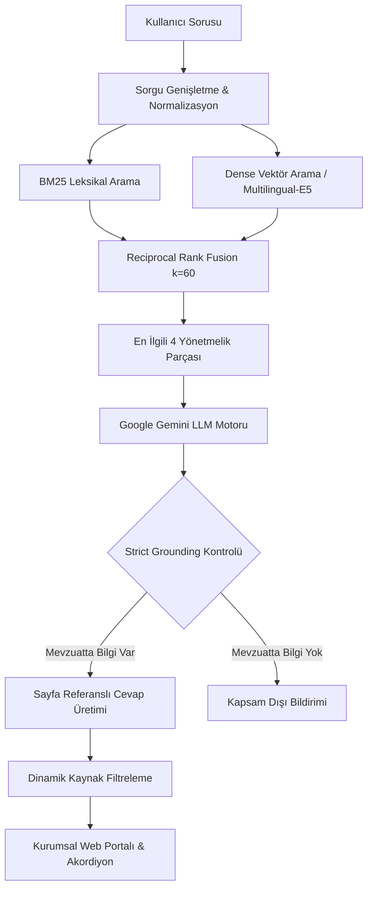

# 🏛️ Kayseri Üniversitesi (KAYÜ) Mevzuat Danışmanı

> **Kayseri Üniversitesi Senato Yönetmelik ve Yönergeleri için Saf Python Hibrit RAG (BM25 + Vektör) Arama ve Soru-Cevap Portalı**

[](https://www.python.org/)
[](https://fastapi.tiangolo.com/)
[](https://www.trychroma.com/)
[](https://ai.google.dev/)
[](LICENSE)

---

## 📌 Proje Genel Bakış

Üniversite öğrencileri ve akademisyenler; ders kayıtları, sınav hakları, çift anadal (ÇAP), yatay geçiş, mazeretler, devamsızlık ve yaz okulu gibi resmi prosedürlerde yüzlerce sayfadan oluşan karmaşık mevzuat metinlerini taramak durumundadır.

**KAYÜ Mevzuat Danışmanı**, Kayseri Üniversitesi bünyesindeki **19 resmi senato yönetmelik ve yönergesini** indeksleyen; harici RAG çerçeveleri (*LangChain*, *LlamaIndex* vb.) kullanılmadan **saf Python** ile geliştirilmiş bir Retrieval-Augmented Generation (RAG) sistemidir.

Öğrencilerin doğal dille sorduğu soruları (örneğin *"Alttan FF dersim varken yatay geçiş yapabilir miyim?"* veya *"Sınav notuma itiraz süresi kaç gün?"*), hem leksikal (**BM25**) hem de semantik (**Dense Vektör**) uzayda eşleştirerek doğrudan ilgili yönetmelik maddesinden sayfa atıflı (`[belge.pdf, s.X]`) olarak cevaplar.

---

## 🚀 Öne Çıkan Mühendislik Özellikleri

### 1. Saf Python Mimarisi (No Heavy Frameworks)
Piyasadaki pek çok RAG prototipinin aksine, bu projede gereksiz soyutlama katmanları (abstraction overhead) barındıran kütüphaneler yerine; metin bölme (chunking), leksikal indeksleme, embedding yönetimi ve **Reciprocal Rank Fusion (RRF)** sıralaması doğrudan saf Python ve ChromaDB ile uygulanmıştır.

### 2. Hibrit Arama Hattı (BM25 + Dense Vektör)
Mevzuat belgelerinde "FF", "GANO 2.50", "3 iş günü", "20 AKTS" gibi kritik eşik ve teknik terimler yalnızca semantik vektör araması kullanıldığında kaybolabilmektedir. Leksikal BM25 ve çok dilli yoğun vektör aramasının RRF ile birleştirilmesi sayesinde arama başarısı **%84.6 Hit@3** seviyesine çıkarılmıştır.

### 3. Sıfır Halüsinasyon Prensibi (Strict Grounding)
Model yalnızca sağlanan resmi yönetmelik parçalarında açıkça yer alan bilgileri kullanır:
- Cevapta yer alan her bilgi cümlesinin sonuna `[belge.pdf, s.X]` kaynak atfı zorunlu kılınmıştır.
- Sorulan konu 19 resmi belgenin kapsamı dışındaysa (örn. yemekhane bursu, harici barınma koşulları) model tahmin yürütmez; ilgili bilginin mevzuatta yer almadığını açıkça belirtir.

### 4. Dinamik Kaynak Filtreleme (`filter_used_sources`)
Model yanıt ürettiğinde, arama motorunun getirdiği 4 parçanın tamamı değil; yalnızca modelin yanıt metninde **bizzat atıfta bulunduğu** resmi belgeler regex ile ayıklanarak arayüzde gösterilir. Alakasız veya kullanılmayan belgeler kullanıcıya sunulmaz.

---

## 📊 Arama Yaklaşımları ve Deneysel Sonuçlar

Sistem, 26'sı doğrudan mevzuat içi ve 6'sı kapsam dışı (abstention) olmak üzere **32 gerçekçi öğrenci sorusundan** oluşan değerlendirme veri seti (`eval/questions.json`) üzerinde test edilmiştir:

| Arama Yöntemi | Hit@1 | Hit@3 | MRR | Açıklama |
| :--- | :---: | :---: | :---: | :--- |
| **Saf Vektör Arama** (`multilingual-e5-base`) | %50.0 | %80.8 | 0.647 | Semantik benzerlik; teknik kısaltmaları kaçırabiliyor. |
| **Parça Başlığı Eklenmiş Vektör** | %50.0 | %80.8 | 0.631 | Genel anahtar kelimelerde yanlış yönetmeliğe kayma gözlendi. |
| **BM25 + Vektör Hibrit (RRF k=60)** | **%65.4** | **%84.6** | **0.747** | **Öğrenci terimlerini ("ff", "gano", "itiraz") tam isabetle yakaladı.** |

*Detaylı hata analizi ve deney günlüğü için [eval/sonuclar.md](eval/sonuclar.md) dosyasını inceleyebilirsiniz.*

---

## 🏗️ Mimari Şema



---

## 💻 Kullanıcı Arayüzü Özellikleri

- **Merkez Odaklı Kurumsal Tasarım:** Yan panel kargaşasından uzak, 880px ferah genişlikte sade ve okunaklı düzen.
- **Taranan 19 Resmi Belge Modalı:** Üst menüden tek tıkla sistemin bildiği tüm senato kararlarını sayfa sayılarıyla inceleme imkanı.
- **Tek Tıkla Kopyalama:** Cevap kartındaki "Kopyala" butonuyla yanıtı panoya aktarma.
- **Şeffaf Akordiyon:** Her cevabın altında, dayanak alınan resmi yönetmeliğin ilgili sayfasındaki orijinal metni açıp inceleme.

---

## 📂 Dizin Yapısı

```
kayu-rag/
├── data/
│   ├── pdfs/                 # 19 adet resmi KAYÜ senato yönetmelik ve yönergesi
│   └── envanter.csv          # PDF metin katmanı, karakter ve sayfa dökümü
├── db/                       # ChromaDB kalıcı vektör indeksi
├── eval/
│   ├── questions.json        # 32 soruluk test ve değerlendirme veri seti
│   ├── run_eval.py           # Otomatik Hit@k ve MRR benchmark scripti
│   └── sonuclar.md           # Karşılaştırmalı deney raporu
├── src/
│   ├── api.py                # FastAPI REST API ve statik dosya sunucusu
│   ├── generate.py           # Hibrit arama, prompt şablonu ve Gemini yanıt motoru
│   └── make_inventory.py     # PDF metin çıkarımı ve envanter denetimi
├── web/
│   ├── index.html            # Kurumsal web portalı arayüzü
│   ├── style.css             # Açık tema, kart tasarımları ve responsive stiller
│   └── app.js                # İstemci mantığı, akordiyon ve panoya kopyalama
├── mini_rag.py               # Çerçevesiz saf Python arama motoru
├── requirements.txt          # Python bağımlılıkları listesi
├── run.sh                    # Tek komutla sunucuyu başlatan kabuk scripti
├── .env.example              # Örnek çevre değişkenleri
└── README.md                 # Proje dokümantasyonu
```

---

## 🛠️ Kurulum ve Çalıştırma

### Gereksinimler
- Python 3.10 veya üzeri
- Google Gemini API Anahtarı ([Google AI Studio](https://aistudio.google.com/)'dan ücretsiz temin edilebilir)

### 1. Depoyu Klonlayın
```bash
git clone https://github.com/kullaniciadi/kayu-rag.git
cd kayu-rag
```

### 2. Bağımlılıkları Yükleyin
```bash
pip install -r requirements.txt
```

### 3. API Anahtarınızı Tanımlayın
`.env.example` dosyasını `.env` olarak kopyalayın ve anahtarınızı ekleyin:
```bash
cp .env.example .env
```
`.env` içeriği:
```env
GEMINI_API_KEY=AIzaSy...
```

### 4. Sistemi Başlatın
Hazır başlatıcı script ile:
```bash
chmod +x run.sh
./run.sh
```
Veya doğrudan Uvicorn ile:
```bash
python3 -m uvicorn src.api:app --host 127.0.0.1 --port 8000 --reload
```

Tarayıcınızdan **`http://127.0.0.1:8000`** adresine giderek sistemi kullanabilirsiniz.

### 5. Değerlendirmeyi Çalıştırma (Benchmark)
Arama hattının Hit@1, Hit@3 ve MRR metriklerini test etmek için:
```bash
python3 eval/run_eval.py
```

---

## 📜 Kapsamdaki 19 Resmi Belge

1. Ön Lisans ve Lisans Eğitim-Öğretim ve Sınav Yönetmeliği
2. Lisansüstü Eğitim ve Öğretim Yönetmeliği
3. YÖK Kurum İçi ve Kurumlar Arası Yatay Geçiş, ÇAP ve Yandal Yönetmeliği
4. Kurum İçi Yatay Geçiş, Çift Anadal (ÇAP) ve Yandal Yönergesi
5. Yaz Okulu Yönergesi
6. Ön Lisans ve Lisans Sınav ve Başarı Değerlendirme Yönergesi
7. Ders Muafiyeti ve İntibak İşlemleri Yönergesi
8. Öğrenci Haklı ve Geçerli Nedenler Yönergesi (Mazeret Esasları)
9. Azami Öğrenim Süresi Sonunda Mezun Olamayanlar Yönergesi
10. İşletmede Mesleki Eğitim Yönergesi
11. Ön Lisans ve Lisans Düzeyinde Uygulamalı Eğitimler Yönergesi
12. AKTS Kredilendirme Yönergesi
13. Bologna Süreci Uyum Yönergesi
14. Özel Öğrenci Yönergesi
15. Yabancı Uyruklu Öğrenci Başvuru ve Kayıt Yönergesi
16. Mikro Yeterlilik Yönergesi
17. Yabancı Dil Muafiyet Sınavları Yönergesi
18. Önceki Öğrenmelerin Tanınması Yönergesi
19. Üniversite Seçmeli Dersler Yönergesi

---

## ⚖️ Lisans

Bu proje [MIT Lisansı](LICENSE) kapsamında açık kaynak olarak sunulmaktadır.
Mevzuat metinlerinin telif hakları Kayseri Üniversitesi'ne aittir.
