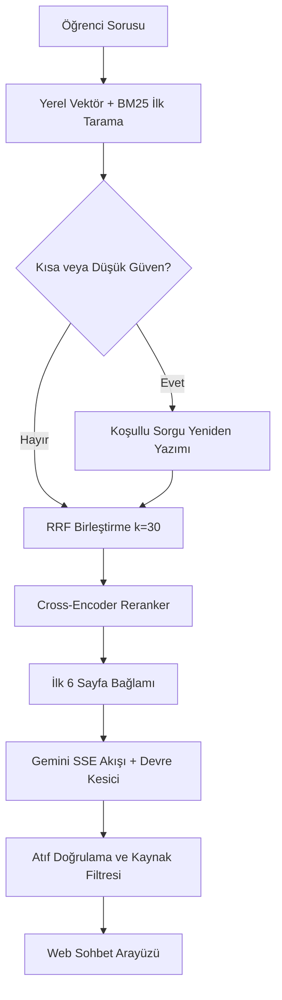

# KAYÜ Mevzuat Asistanı

[](https://www.python.org/)
[](https://fastapi.tiangolo.com/)
[](https://www.trychroma.com/)
[](https://www.sbert.net/)
[](https://ai.google.dev/)
[](LICENSE)

Kayseri Üniversitesi (KAYÜ) Senatosu tarafından yayımlanan 19 resmi yönetmelik ve yönerge üzerinde çalışan; madde-duyarlı parçalama, hibrit arama (BM25 + Vektör), Cross-Encoder yeniden sıralama ve Google Gemini SSE akışı ile kaynak atıflı yanıt üreten mevzuat danışmanı.

> **Not:** Bu proje akademik/öğrenci amaçlı bir prototiptir. Yalnızca indekslenen 19 resmi PDF belgesini referans alır ve resmi bağlayıcılığı yoktur; resmi işlemlerde Kayseri Üniversitesi Öğrenci İşleri Daire Başkanlığı ve ilgili birimlerin kararları esastır.

---

## Kapsam (19 Resmi Belge)

**Yönetmelikler (3)**
1. Ön Lisans ve Lisans Eğitim-Öğretim ve Sınav Yönetmeliği (12 sayfa)
2. Lisansüstü Eğitim ve Öğretim Yönetmeliği (24 sayfa)
3. YÖK Kurumlar Arası ve Kurum İçi Yatay Geçiş, ÇAP ve Yandal Yönetmeliği (13 sayfa)

**Senato Yönergeleri ve Usul Esasları (16)**
4. Kurum İçi Yatay Geçiş, Çift Anadal (ÇAP) ve Yandal Yönergesi (8 sayfa)
5. Yaz Okulu Yönergesi (3 sayfa)
6. Ön Lisans ve Lisans Sınav ve Başarı Değerlendirme Yönergesi (9 sayfa)
7. Ders Muafiyeti ve İntibak İşlemleri Yönergesi (4 sayfa)
8. Öğrenci Haklı ve Geçerli Nedenler Yönergesi (4 sayfa)
9. Azami Öğrenim Süresi Sonunda Mezun Olamayanlar Yönergesi (6 sayfa)
10. İşletmede Mesleki Eğitim Yönergesi (7 sayfa)
11. Ön Lisans ve Lisans Düzeyinde Uygulamalı Eğitimler Yönergesi (10 sayfa)
12. AKTS Kredilendirme Yönergesi (4 sayfa)
13. Bologna Süreci Uyum Yönergesi (3 sayfa)
14. Özel Öğrenci Yönergesi (4 sayfa)
15. Yabancı Uyruklu Öğrenci Başvuru ve Kayıt Yönergesi (7 sayfa)
16. Mikro Yeterlilik Yönergesi (5 sayfa)
17. Yabancı Dil Muafiyet Sınavları Yönergesi (5 sayfa)
18. Önceki Öğrenmelerin Tanınması Yönergesi (3 sayfa)
19. Üniversite Seçmeli Dersler Yönergesi (3 sayfa)

---

## Sistem Mimarisi

Harici orkestrasyon çerçeveleri yerine hafif ve denetlenebilir saf Python boru hattı kullanılmıştır; tüm retrieval parametreleri [config/retrieval.yaml](config/retrieval.yaml) üzerinden yönetilir.

- **Madde-Duyarlı Parçalama ve Üst Bilgi Temizliği (`mini_rag.py`):** Tekrarlayan sayfa başlığı ve kalite yönetim tabloları ayıklanır; metinler `MADDE` sınırlarına duyarlı şekilde bölünür ve her parçanın başına `[Belge Adı | Konu (MADDE X)]` bağlam etiketi eklenir.
- **Hibrit Arama ve RRF (`mini_rag.py`):** Türkçe ASCII normalizasyonlu + `#stem5` morfolojik köklü BM25 ile yoğun vektör araması (`intfloat/multilingual-e5-base` + ChromaDB) Reciprocal Rank Fusion (`k=30`) ile birleştirilir.
- **Koşullu Sorgu Yeniden Yazımı (`src/query_rewrite.py`):** Kısa, devrik veya düşük eşleşmeli sorgular kural uydurmadan resmi mevzuat terimlerine çevrilir, öğrenim düzeyi (`onlisans_lisans` / `lisansustu` / `genel`) belirlenir ve sonuçlar önbelleklenir.
- **Cross-Encoder Yeniden Sıralama (`mini_rag.py`):** İlk aday havuzu (`candidate_pool=20`) `cross-encoder/mmarco-mMiniLMv2-L12-H384-v1` modeliyle yeniden skorlanır, RRF skoruyla harmanlanır (`rrf_blend_weight=0.35`) ve sayfa bazında tekilleştirilir.
- **Hızlı Gemini SSE Akışı ve Atıf Doğrulama (`src/generate.py`):** Sunucu açılışında modeller ısıtılır (`warmup`); devre kesicili, paralel yedekli (hedged) akış ve bellek içi yanıt önbelleği ile düşük gecikmeli yanıt üretilir. Üretilen yanıttaki `[belge.pdf, s.X]` atıfları `citation_audit` ile bağlamdaki gerçek sayfalara karşı doğrulanır.



---

## Değerlendirme Sonuçları (Faz 6)

Veri sızıntısını önlemek için geliştirme seti (`eval/dev.json`) dışında, 19 PDF belgeden bağımsız ve SHA-256 ile kilitlenmiş üç test seti kullanılmıştır (`eval/sonuclar.md`):

| Veri Seti | Soru | Hit@1 | Hit@3 | Hit@5 | MRR | E2E Doğru+Kısmen | Geçerli Atıf | Gereksiz Abstention |
| :--- | :---: | :---: | :---: | :---: | :---: | :---: | :---: | :---: |
| **Kilitli Test Seti** (`eval/test_locked.json`) | 80 | **%96.2** | **%100.0** | **%100.0** | **0.981** | **%100.0** | **%98.7** | **%0.0** |
| **Kısa / Gürültülü Set** (`eval/noisy.json`) | 60 | **%76.7** | **%90.0** | **%93.3** | **0.832** | **%94.6** | **%94.6** | **%0.0** |
| **Geliştirme Seti** (`eval/dev.json`) | 40 | %62.5 | %92.5 | %97.5 | 0.760 | %83.3 | %97.2 | %2.8 |

- **Kapsam Dışı / Cevapsız Sorularda Çekimserlik (`eval/unanswerable.json`, n=30):** **%93.3** (28/30, %95 GA: %83.3–%100.0).
- **Sınırlılıklar:** Sistem yalnızca 19 genel senato belgesini kapsar; bölüm bazlı müfredat detayları, güncel akademik takvim/duyurular ve harç tutarları kapsam dışıdır.

---

## Web Arayüzü

- **Sohbet Geçmişi ve Yan Panel:** Önceki görüşmeleri tarayıcıda saklar, tek tıkla geri yükler veya temizler.
- **Canlı SSE Akışı ve Durdurma:** Yanıtlar kelime kelime akar; istenirse üretim anında durdurulabilir.
- **Etkileşimli Kaynak Doğrulama:** Metin içi `[belge.pdf, s.X]` etiketlerine tıklandığında ilgili resmi sayfa metni akordiyonu otomatik açılır.
- **Aranabilir 19 Belge İndeksi:** Üst bar ve yan panelden erişilebilen modal üzerinden tüm yönetmelik ve yönergeler filtrelenebilir.

---

## Dizin Yapısı

```text
kayu-rag/
├── config/
│   └── retrieval.yaml        # Embedding, BM25, RRF, reranker ve rewrite ayarları
├── data/
│   ├── yonergeler/           # 16 adet yönerge PDF'i
│   ├── yonetmelikler/        # 3 adet yönetmelik PDF'i
│   └── envanter.csv          # Belge sayfa ve yürürlük tarihi envanteri
├── db/                       # ChromaDB indeksi ve rewrite önbelleği (git dışı)
├── eval/
│   ├── dev.json              # Geliştirme seti (40 cevaplı + 10 cevapsız)
│   ├── test_locked.json      # Kilitli final test seti (80 soru)
│   ├── test_locked.sha256    # Bütünlük doğrulama özeti
│   ├── noisy.json            # Kısa / gürültülü stres seti (60 soru)
│   ├── unanswerable.json     # Kapsam dışı / cevapsız set (30 soru)
│   ├── judge.py              # LLM-Hakem değerlendirme modülü
│   ├── run_eval.py           # Retrieval + E2E benchmark scripti
│   └── sonuclar.md           # Ayrıntılı deney kayıtları
├── src/
│   ├── api.py                # FastAPI sunucusu, warmup ve SSE (/api/ask/stream)
│   ├── generate.py           # Gemini akışı, devre kesici, önbellek ve atıf denetimi
│   ├── query_rewrite.py      # Sorgu yeniden yazma ve JSON önbellek
│   └── make_inventory.py     # PDF envanter denetim aracı
├── web/
│   ├── index.html            # Chatbot arayüzü
│   ├── style.css             # Arayüz stilleri
│   └── app.js                # SSE okuyucu ve sohbet istemcisi
├── mini_rag.py               # Parçalama, indeksleme, hibrit arama ve reranking
├── requirements.txt          # Python bağımlılıkları
├── run.sh                    # Başlatma scripti
└── .env.example              # Ortam değişkeni şablonu
```

---

## Kurulum ve Çalıştırma

### Gereksinimler
- Python 3.10+
- Google Gemini API anahtarı ([Google AI Studio](https://aistudio.google.com/))

### Kurulum
```bash
git clone https://github.com/erimlers/kayu-rag.git
cd kayu-rag
pip install -r requirements.txt
cp .env.example .env
```

`.env` dosyasına API anahtarınızı ekleyin:
```env
GEMINI_API_KEY=AIzaSy...
```

### İndeks Oluşturma (Gerekirse)
`db/` dizini yoksa veya PDF belgeleri güncellendiyse:
```bash
python3 mini_rag.py index
```

### Sunucuyu Başlatma
```bash
chmod +x run.sh
./run.sh
```
Alternatif olarak doğrudan Uvicorn ile:
```bash
python3 -m uvicorn src.api:app --host 127.0.0.1 --port 8000 --reload
```
Arayüz adresi: `http://127.0.0.1:8000`

### Değerlendirme (Benchmark)
```bash
# Retrieval metriği (dev seti)
python3 eval/run_eval.py --dataset eval/dev.json --no-log

# Kilitli test seti üzerinde uçtan uca değerlendirme
python3 eval/run_eval.py --dataset eval/test_locked.json --k 6 --e2e --no-log
```

---

## Lisans

Bu proje [MIT Lisansı](LICENSE) altında paylaşılmıştır. Mevzuat metinlerinin tüm hakları Kayseri Üniversitesi'ne aittir.
